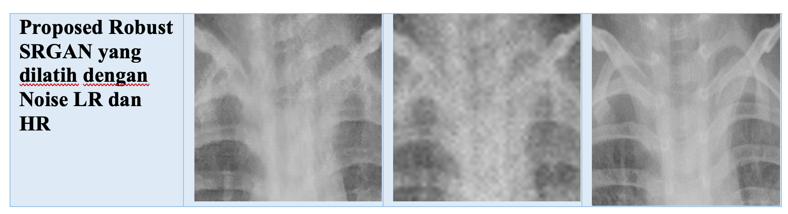
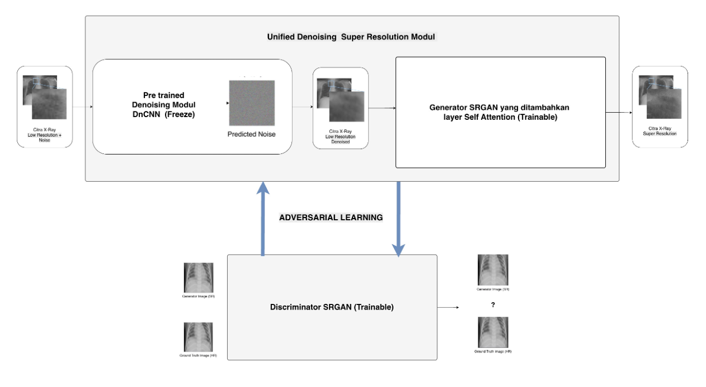
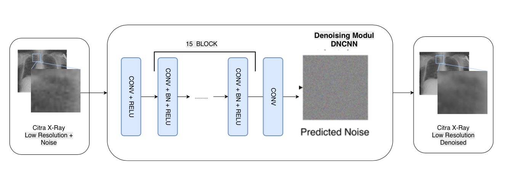
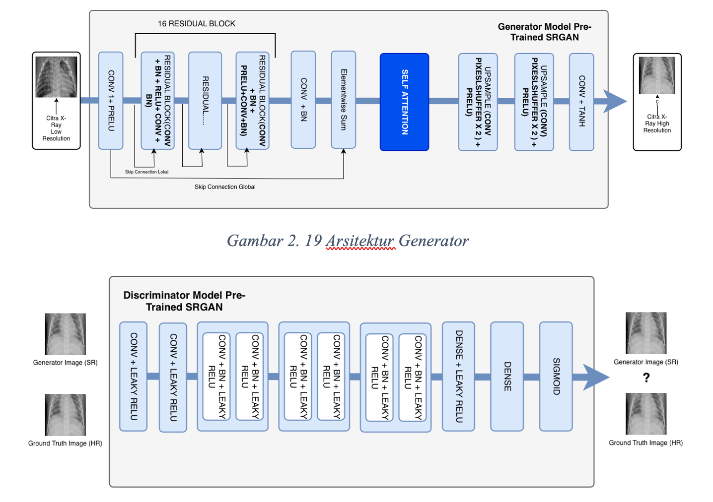
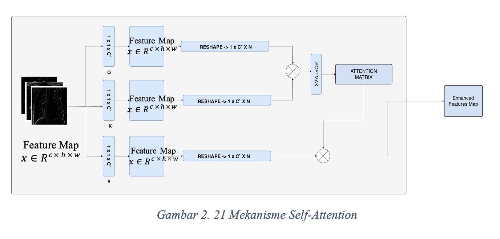
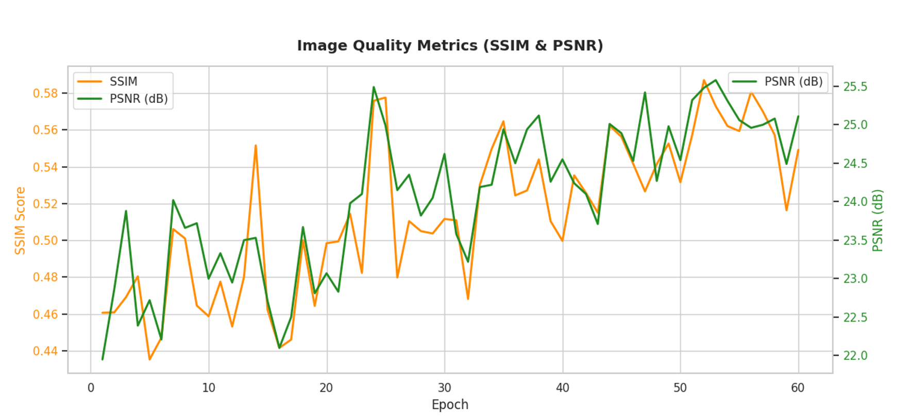
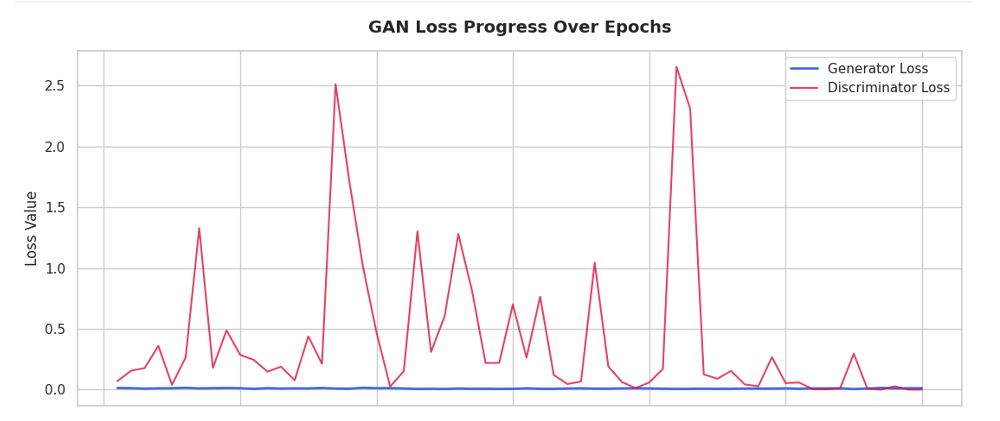
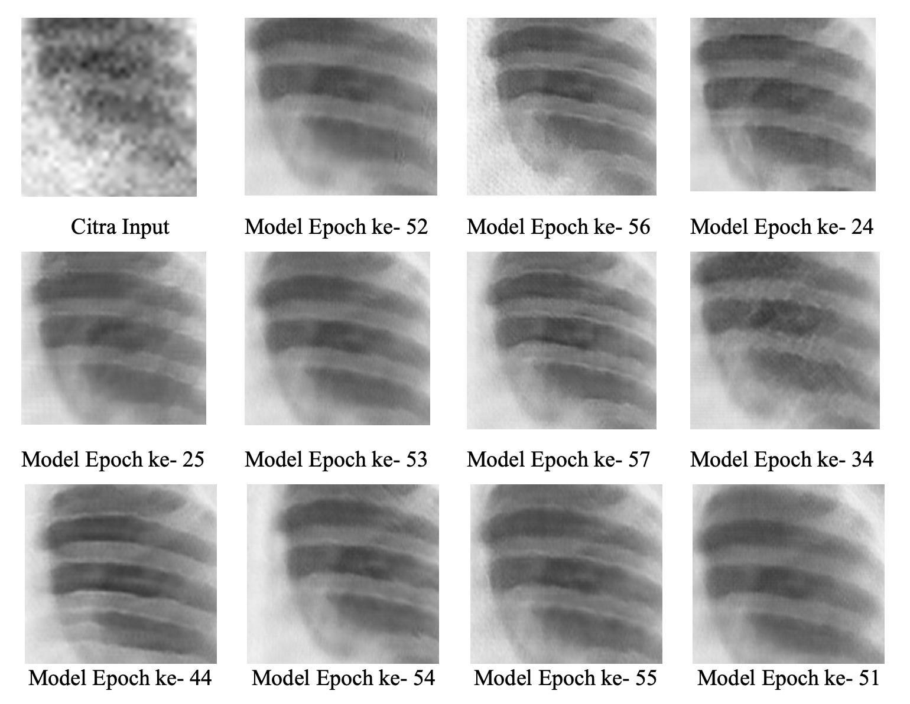

# IMPLEMENTATION OF A ROBUST SRGAN FOR SUPER-RESOLUTION IMAGING OF PEDIATRIC PNEUMONIA CHEST X-RAYS

*Left:Output Image, Middle:Input Noise Image, Right:Ground Truth*

A noise-robust super-resolution pipeline for chest X-ray (CXR) images. A **DnCNN** denoising module is placed in front of an **SRGAN** generator (with self-attention and a modified, **CheXNet-based perceptual loss**), so that low-resolution (LR) images corrupted by Gaussian noise can be restored to clean high-resolution (HR) output.

---

## Pipeline Overview

- The DnCNN module is **trained individually first**, then **frozen** and used inside the joint Robust SRGAN training pipeline.
- The quality of the DnCNN output directly affects the generator: poor denoised LR images lead to poor HR reconstructions.
- Noise model: Gaussian noise with standard deviation (noise level) between **5 and 15**.

---

## 1. DnCNN Denoising Module

**Evaluation:** PSNR, SSIM, loss curves, and visual inspection across training, validation, and testing.

### Training results

| Metric | Result |
|---|---|
| PSNR (training, plateau near step ~28,190) | **35.547 dB** |
| SSIM (training) | **0.9492** |
| Final training loss | **0.3757** |

Notes:
- Metrics are logged every 10 batches (1 step = 10 batches).
- PSNR rises sharply until about step 5,000, fluctuates because of varying image difficulty and noise level per mini-batch, and stabilizes from about step 20,000.
- Validation metrics follow the same upward trend per epoch as training, indicating **no sign of overfitting**.

### Test-set results per checkpoint (10 epochs)

| Epoch | PSNR (dB) | SSIM |
|---:|---:|---:|
| 1 | 29.6731 | 0.8291 |
| 2 | 27.9596 | 0.7637 |
| 3 | 27.2161 | 0.7478 |
| 4 | 29.5656 | 0.8232 |
| 5 | 29.2953 | 0.8130 |
| 6 | 29.2635 | 0.8201 |
| 7 | 27.8225 | 0.7614 |
| 8 | 28.9942 | 0.8061 |
| 9 | 28.8289 | 0.7935 |
| **10** | **30.5656** | **0.8552** |

**Selected checkpoint: epoch 10** (highest PSNR and SSIM). Visually, DnCNN removes high-frequency noise while preserving lung anatomy, giving SRGAN a clean input. SRGAN then recovers texture and structural detail through its adversarial and perceptual losses.

---
## 2. Robust SRGAN Training

**Proposed modifications over the baseline SRGAN:**

- **Self-attention** added to the generator, so the network can capture long-range dependencies and keep anatomical structures consistent across the chest X-ray.

- **Modified perceptual loss using CheXNet**: instead of the standard VGG-based feature loss, perceptual features are extracted from CheXNet, a network trained on chest X-rays. The loss therefore compares images in a domain-specific, clinically relevant feature space.
- **Integrated DnCNN denoising module** (frozen) in front of the generator, as described above.

**Training setup:**

- Trained for **60 epochs**; each epoch logs PSNR, SSIM, generator loss (G_Loss), and discriminator loss (D_Loss).

| Quantity | Range over 60 epochs |
|---|---|
| PSNR | ~21.95 – 25.58 dB |
| SSIM | ~0.435 – 0.587 |
| G_Loss | ~0.0056 – 0.0155 (close to 0 throughout) |
| D_Loss | ~0.0003 – 2.65 (strongly fluctuating) |

### Interpretation

- PSNR and SSIM trend upward without extreme jumps or drops, and there are no signs of severe overfitting.

- These values are lower than standalone SRGAN (SSIM > 0.8) or DnCNN (SSIM ~0.94). This is expected: Robust SRGAN has a harder optimization problem because it combines three modifications: the integrated DnCNN denoising module, self-attention in the generator, and the CheXNet-based perceptual loss. Standalone SRGAN and DnCNN do not carry this combined burden (DnCNN in particular focuses purely on pixel-level metrics).
- Because the CheXNet perceptual loss compares chest-X-ray-specific features rather than raw pixels, and self-attention lets the generator reshape global structure, Robust SRGAN prioritizes visual realism, noise removal, and anatomical sharpness over pixel-by-pixel matching with the ground truth. Small structural shifts or micro-variations in tissue regions can lower PSNR/SSIM sharply even when the image is clinically sharp and clean.
- Fluctuating discriminator loss is normal in adversarial training: the two networks compete, and as the generator improves the discriminator struggles. The generator loss stays near zero, indicating stable learning.

---

## 3. Model Selection

### 3.4 Preliminary visual selection
Eleven candidate epochs were shortlisted from visual inspection of output images

### 3.5 Comparison with ground truth and noisy LR input
- Models from **epoch > 50** tend to produce **vertical-line artifacts**. This suggests that the learning-rate scheduler used after epoch 50 (0.001 → 0.0001) is not effective for this setup.
- **Epochs 25 and 34** give high-resolution CXR images with minimal artifacts and good fidelity to the ground truth.
- Between the two, **epoch 25 is slightly sharper** and is chosen as the **best model**.

| Selected model | PSNR (dB) | SSIM |
|---|---:|---:|

| Epoch 25 | 24.99 | 0.5776 |

> Selection is based on artifact analysis, standard quantitative metrics (PSNR/SSIM), and perceptual-feature consistency. **No radiology expert has evaluated the outputs yet.**

---

## 4. Ablation Study (3.6)

Evaluates the contribution of each proposed component: DnCNN-based denoising, self-attention, and the modified perceptual loss.

| Scheme | Training pairs | Status |
|---|---|---|
| DnCNN only | Noisy LR → clean LR | Done |
| SRGAN + Attention + modified perceptual loss | Clean LR → HR | Done |
| SRGAN + Attention + modified perceptual loss | Noisy LR → HR | *In progress* |
| SRGAN baseline + modified perceptual loss | Clean LR → HR | Done |
| **Proposed Robust SRGAN** | Noisy LR → HR | Done |

Written analysis of the ablation results: *In progress.*

---

## Key Takeaways

1. DnCNN reaches ~35.5 dB PSNR / 0.949 SSIM on training data, and epoch 10 is selected as the denoising module.
2. Robust SRGAN trains stably over 60 epochs; its lower pixel-based metrics reflect a harder objective and a focus on perceptual quality.
3. Late-epoch checkpoints (> 50) show vertical-line artifacts, so the post-epoch-50 learning-rate decay is not recommended.
4. **Epoch 25** is the current best Robust SRGAN checkpoint, pending expert evaluation.

